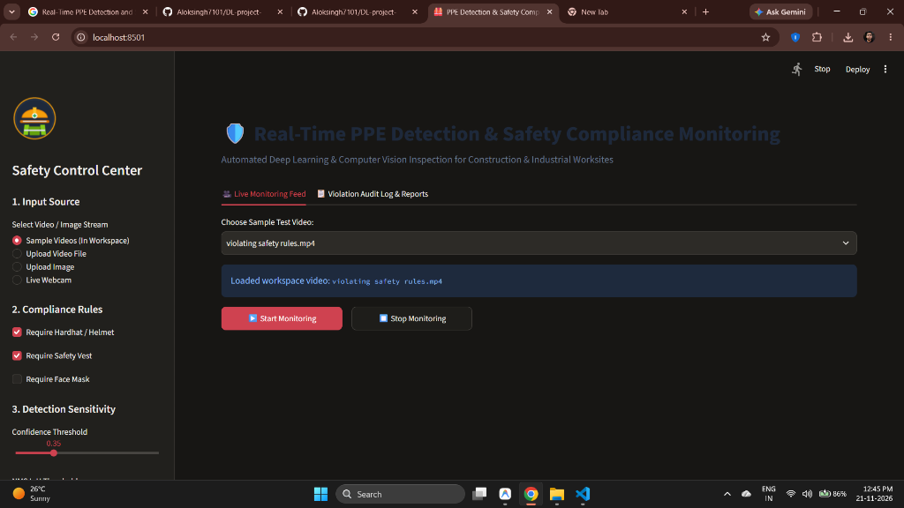
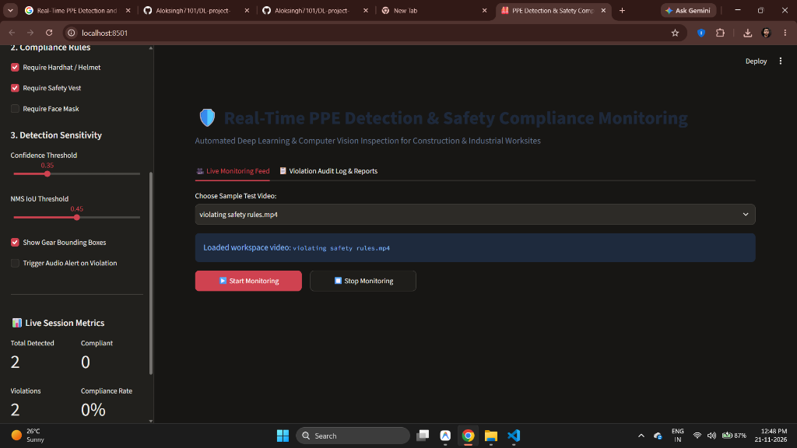
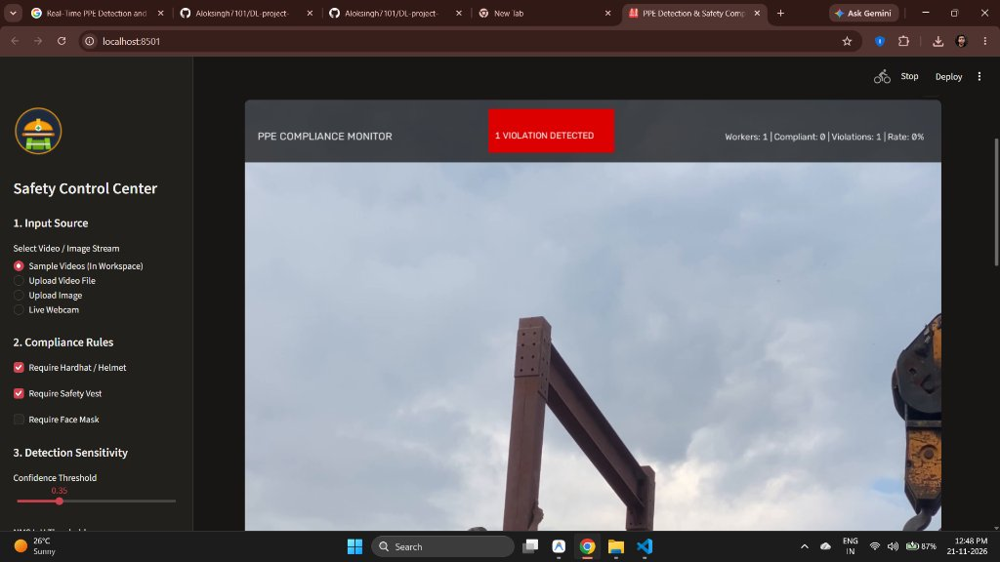
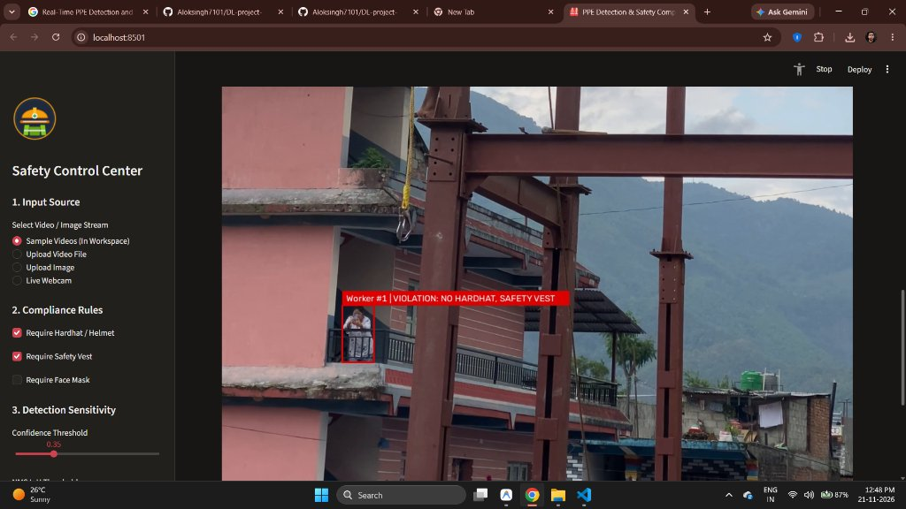

<div align="center">


# 🛡️ Real-Time PPE Detection & Safety Compliance Monitoring

### Using Deep Learning (YOLOv8 + OpenCV + Streamlit)

[](https://python.org)
[](https://ultralytics.com)
[](https://streamlit.io)
[](https://opencv.org)
[](LICENSE)

> **Automatically detects workers on construction sites and checks in real-time whether they are wearing their required Personal Protective Equipment (PPE) — such as a Safety Helmet and High-Visibility Vest — and raises instant visual alerts for any safety violations.**

</div>

---

## 📸 App Screenshots

| Dashboard & Controls | Live Metrics |
|:---:|:---:|
|  |  |

| Violation Detected (HUD Alert) | Worker Annotation — NO HARDHAT, NO VEST |
|:---:|:---:|
|  |  |

---

## 🤔 What Problem Does This Solve?

Every year, thousands of construction workers are injured or killed due to not wearing proper safety gear. Manually monitoring every worker on a large worksite is impossible for site supervisors.

This project uses **Deep Learning AI** to automatically watch video footage (or a live camera) and:
- ✅ **Detect every worker** in the frame
- ✅ **Check if they are wearing** a safety helmet and high-visibility vest
- ✅ **Draw green boxes** around compliant workers
- 🚨 **Draw red boxes and alerts** when a worker is missing safety gear
- 📋 **Log every violation** with a timestamp and photo for audit reports

---

## ✨ Key Features

| Feature | Description |
|:---|:---|
| 🎯 **YOLOv8 Person Detection** | State-of-the-art deep learning model detects workers in any pose (standing, climbing, kneeling) |
| 🦺 **PPE Compliance Check** | Checks for Safety Helmet (Hardhat) and High-Visibility Safety Vest per worker |
| 🟢 **Green Box** | Worker is wearing all required PPE — Compliant |
| 🔴 **Red Box + Alert Label** | Worker is missing PPE — `VIOLATION: NO HARDHAT, SAFETY VEST` |
| 👤 **Worker Tracking** | Each worker gets a persistent identity (`Worker #1`, `Worker #2`) across frames |
| 📊 **Live KPI Dashboard** | Real-time counts of Total Workers, Compliant, Violations, and Compliance Rate % |
| 🎥 **Multiple Input Modes** | Supports sample videos, uploaded videos, uploaded images, and live webcam |
| 📋 **Violation Log + CSV Export** | Every violation is timestamped and exportable as a CSV for OSHA audit reports |
| 📸 **Snapshot Capture** | Automatically saves a photo of each violating worker |

---

## 🏗️ How It Works — System Architecture

```
📹 Input (Video / Image / Webcam)
         │
         ▼
┌─────────────────────────┐
│   YOLOv8 Person         │  ← Detects every person in the frame
│   Detection Model       │    (yolov8n.pt — fast & accurate)
└─────────────┬───────────┘
              │  Person bounding box crops
              ▼
┌─────────────────────────┐
│  PPE Compliance Engine  │  ← Two-layer check per worker:
│  (detector.py)          │    1. Dedicated PPE Model (ppe_yolov8.pt)
│                         │    2. HSV Color Analysis (helmet & vest colors)
└─────────────┬───────────┘
              │  Compliant / Violation status
              ▼
┌─────────────────────────┐
│   Worker Tracker        │  ← Assigns Worker #IDs, smooths results
│   (tracker.py)          │    across frames to avoid flickering
└─────────────┬───────────┘
              │
              ▼
┌─────────────────────────┐
│   Visualizer + HUD      │  ← Draws colored boxes, labels, top banner
│   (visualizer.py)       │
└─────────────┬───────────┘
              │
              ▼
┌─────────────────────────┐
│  Streamlit Dashboard    │  ← Web UI: live feed, metrics, violation log
│  (app.py)               │
└─────────────────────────┘
```

---

## 🚀 Getting Started

### Prerequisites
- Python 3.10 or higher
- Windows / Linux / macOS
- Git installed
- A webcam (optional, for live monitoring)

### Step 1 — Clone the Repository
```bash
git clone https://github.com/Aloksingh7101/DL-project-.git
cd DL-project-
```

### Step 2 — Create a Virtual Environment
```bash
# Windows
python -m venv .venv
.\.venv\Scripts\Activate.ps1

# Linux / macOS
python3 -m venv .venv
source .venv/bin/activate
```

### Step 3 — Install All Dependencies
```bash
pip install -r requirements.txt
```
> This will install: `ultralytics`, `streamlit`, `opencv-python`, `torch`, `pandas`, `pillow`, and more.

### Step 4 — Add Your Test Videos *(Optional)*
Place your `.mp4` or `.avi` video files inside the `testing vidio/` folder.
> The app will automatically show them in the **"Sample Videos"** dropdown.

### Step 5 — Run the Web Dashboard
```bash
streamlit run app.py
```
Then open your browser at 👉 **http://localhost:8501**

---

## 🖥️ Using the Web App

### Sidebar — Safety Control Center

| Section | What to do |
|:---|:---|
| **1. Input Source** | Choose between Sample Video, Upload Video, Upload Image, or Live Webcam |
| **2. Compliance Rules** | Toggle which PPE items are required (Hardhat ✅, Vest ✅, Mask optional) |
| **3. Detection Sensitivity** | Adjust Confidence Threshold (0.35 recommended) and IoU Threshold (0.45) |
| **Show Gear Boxes** | Toggle on to see inner boxes around detected helmets and vests |
| **Audio Alert** | Enable buzzer sound when a violation is detected |
| **Live Session Metrics** | See Total Detected, Compliant, Violations, and Compliance Rate live |
| **Reset Button** | Clear all session stats and start fresh |

### Main Area — Monitoring Feed

1. Select your input source from the sidebar
2. Click **▶️ Start Monitoring**
3. Watch the live annotated video feed:
   - 🟢 Green box + `Worker #1 | COMPLIANT` → Safe worker
   - 🔴 Red box + `Worker #1 | VIOLATION: NO HARDHAT, SAFETY VEST` → Unsafe worker
4. Click **⏹️ Stop Monitoring** when done

### Violation Audit Log Tab
- View a full timestamped table of every safety violation detected
- Click **📥 Download Violation Log (CSV)** to export for safety reports
- View automatically captured snapshot photos of each violating worker

---

## 📂 Project Structure

```
DL-project-/
│
├── app.py                  # 🌐 Main Streamlit web application
├── detector.py             # 🔍 PPE detection engine (YOLOv8 + HSV analysis)
├── tracker.py              # 👤 Multi-worker identity tracking
├── visualizer.py           # 🎨 Bounding boxes, HUD banner, annotations
├── config.py               # ⚙️  Paths, colors, class names, default settings
├── test_pipeline.py        # 🧪 Headless CLI batch test script
├── requirements.txt        # 📦 All Python dependencies
│
├── assets/
│   ├── logo.png                    # App sidebar logo
│   ├── screenshot_dashboard.png    # App screenshots
│   ├── screenshot_metrics.png
│   ├── screenshot_violation_hud.jpg
│   └── screenshot_detection.jpg
│
├── models/                 # Auto-created: stores downloaded .pt model weights
├── outputs/                # Auto-created: saves annotated videos & snapshots
│   └── snapshots/          # Violation snapshot photos
│
├── testing vidio/          # Place your .mp4 test videos here (not tracked by git)
│
├── .gitignore
└── README.md
```

---

## 🧪 Running the Headless Batch Test

To test the detection pipeline on your videos **without opening a browser**:

```bash
python test_pipeline.py
```

**What it does:**
- Processes the first 50 frames of each video in `testing vidio/`
- Prints per-frame detection summaries in the terminal
- Saves annotated output videos to `outputs/`

**Example output:**
```
==========================================
Testing Video: with saftey rule.mp4
==========================================
Frame 15/50 -> Tracked Workers: 2, Compliant: 2, Violations: 0
Frame 30/50 -> Tracked Workers: 2, Compliant: 2, Violations: 0
Summary: Compliant detections: 100 | Violation detections: 0  ✅

==========================================
Testing Video: violating safety rules.mp4
==========================================
Frame 15/50 -> Tracked Workers: 1, Compliant: 0, Violations: 1
Frame 30/50 -> Tracked Workers: 1, Compliant: 0, Violations: 1
Summary: Compliant detections: 0 | Violation detections: 64  🚨
```

---

## 🤖 Deep Learning Models Used

| Model | Purpose | Size | Source |
|:---|:---|:---|:---|
| `yolov8n.pt` | Detecting people in video frames | ~6 MB | [Ultralytics](https://ultralytics.com) — auto-downloaded |
| `ppe_yolov8.pt` | Detecting specific PPE items (helmet, mask, etc.) | ~22 MB | [HuggingFace](https://huggingface.co/keremberke/yolov8s-protective-equipment-detection) — auto-downloaded |

> Both models download automatically on the first run. No manual setup needed.

---

## 📋 Requirements

```
ultralytics>=8.0.0
streamlit>=1.30.0
opencv-python>=4.8.0
numpy>=1.24.0
pandas>=2.0.0
pillow>=10.0.0
torch>=2.0.0
torchvision>=0.15.0
```

---

## 🔧 Customization

| What to change | Where |
|:---|:---|
| Minimum confidence for detection | Sidebar slider or `config.py → DEFAULT_RULES["confidence_threshold"]` |
| Which PPE is required | Sidebar checkboxes (Hardhat / Vest / Mask) |
| Max frames to test | `test_pipeline.py → max_frames=50` |
| Output video/snapshot paths | `config.py → OUTPUTS_DIR` / `SNAPSHOTS_DIR` |

---

## 👨‍💻 Author

**Alok Singh**
- GitHub: [@Aloksingh7101](https://github.com/Aloksingh7101)

---

## 📜 License

This project is licensed under the **MIT License** — feel free to use, modify, and distribute with attribution.

---

<div align="center">

⭐ **If this project helped you, please give it a star!** ⭐

Made with ❤️ for workplace safety

</div>
